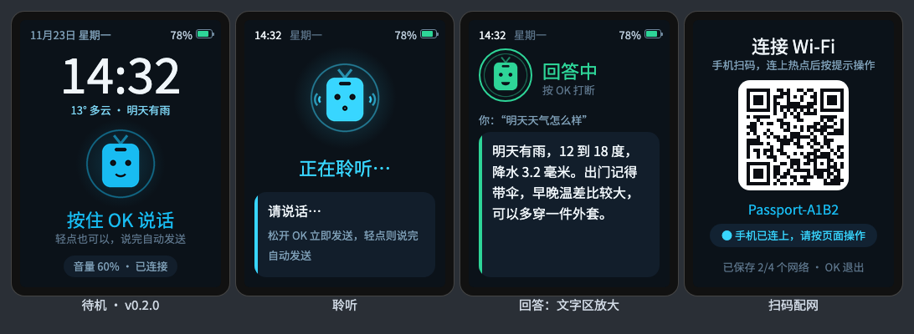
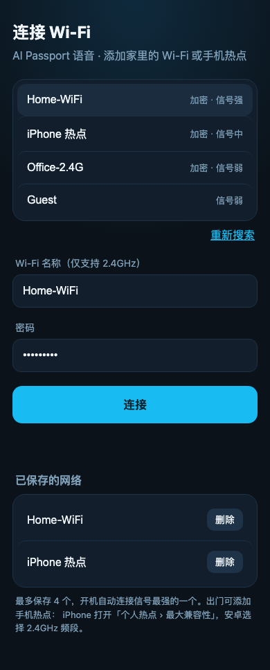
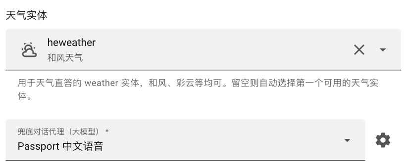
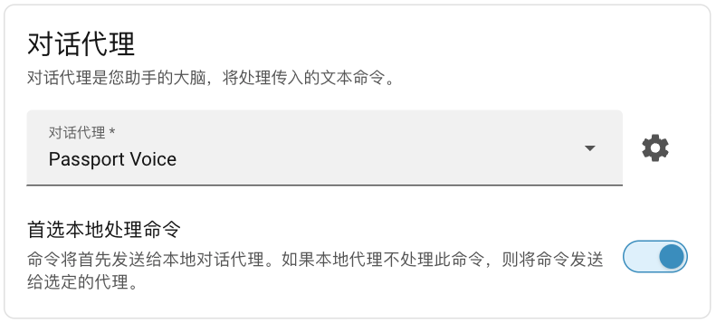

# AiPassport-voice

把 [FoloToy AI Passport](https://github.com/FoloToy/ai-passport) 电子胸牌变成 **Home Assistant Assist 中文语音终端**。

[](https://esphome.io)
[](https://www.home-assistant.io)
[](https://hacs.xyz)
[](#许可证)

本仓库包含两部分：

- **胸牌固件**（`firmware/`）：基于 ESPHome，提供网页一键刷机的预编译固件，也可以自己编译。
- **Home Assistant 配套集成**（`custom_components/ai_passport_voice/`）：时间、日期、天气本地直答，其余问题转交你选择的大模型。可选安装。

## 目录

- [界面截图](#界面截图)
- [功能](#功能)
- [硬件要求](#硬件要求)
- [快速开始](#快速开始)
- [使用说明](#使用说明)
- [配套集成](#配套集成)
- [本地语音合成（推荐）](#本地语音合成推荐)
- [从源码编译](#从源码编译)
- [项目结构](#项目结构)
- [已知限制](#已知限制)
- [许可证](#许可证)
- [致谢](#致谢)

## 界面截图



从左到右：待机（大时钟与天气）、聆听、回答（文字区放大）、扫码配网。

<table>
  <tr>
    <td width="50%" valign="top">
      <br>
      手机扫码后打开的配网页面：选择 Wi-Fi、输入密码，管理已保存的网络。
    </td>
    <td width="50%" valign="top">
      <br>
      状态图标：待机、聆听、思考、回答、出错、离线。
    </td>
  </tr>
</table>

> 胸牌四屏按固件布局渲染，六种图标直接取自固件资源。配网页使用固件内嵌页面和示例网络数据。

## 功能

- **按住说话，松手即发**：按住 OK 键说话，松手立刻发送，不必等待静音检测；轻点则由 HA 判断说完。
- **随时打断**：思考或回答时按 OK，立即停止播放并丢弃旧回答，重新聆听。
- **扫码配网**：屏幕显示二维码，手机扫码即可配置 Wi-Fi，最多保存 4 个网络（比如家里的 Wi-Fi 和手机热点）。开机优先直连上次用过的路由器节点，连不上再扫描并选信号最强的一个。
- **API 加密**：支持动态配对的 Home Assistant（已核对 2026.10.4）会在首次接入后为每台胸牌设置独立密钥。配套集成支持的早期 HA 版本（如 2025.4）需要自行编译并指定密钥才能保证加密。
- **中文界面**：240×320 屏幕，待机大时钟和天气，对话时显示状态、你说的话和完整回答。长回答自动换行，一屏放不下时慢慢上下滚动；字库里没有的符号（如 `·`、`—`、emoji）会替换成相近字符或省略，不显示方框。
- **在线升级**：HA 中出现固件更新实体，新版本发布后可直接在 HA 中升级。
- **省电与深度睡眠**：空闲 45 秒微亮、120 秒息屏并开启 Wi-Fi 省电；息屏后再过 5 分钟，或电量降到 3%，进入深度睡眠。任意键唤醒，约 2 秒即可对话。插在电脑上时不睡，方便调试。
- **播放不卡顿**：提高 ESPHome 扬声器任务的优先级，界面刷新和网络收包时回答也不断音。
- **音质保护**：按官方 BSP 限制 ES8311 增益范围，满音量也不会破音。

## 硬件要求

仅适配 **FoloToy AI Passport**（ESP32-C3 透明电子胸牌）。引脚、电量计和音频参数都是该机型专用的，其他开发板不能直接使用。

| 项目 | 参数 |
| --- | --- |
| 主控 | ESP32-C3，8 MB Flash，无 PSRAM |
| 屏幕 | ST7789，240×320 |
| 音频 | ES8311 编解码，模拟麦克风 + 扬声器 |
| 电源 | 500 mAh 电池，CW2017 电量计，USB-C |
| 按键 | 左侧电源键；右侧上 / 下 / OK 三键 |

Home Assistant 侧需要一条可用的 Assist 管线（语音识别 + 对话代理 + 语音合成）。中文语音建议使用 HA Cloud、[AI Hub](https://github.com/ha-china/ai_hub)（语音识别、语音合成和大模型对话一站式提供），或局域网中的 Wyoming 服务（如 faster-whisper、Piper、EdgeTTS）。

## 快速开始

### 1. 刷入固件

用 Chrome 或 Edge 打开 **[网页刷机页](https://jandoucn.github.io/AiPassport-voice/)**，长按电源键开机后用 USB 连接胸牌，点击“安装”。

> 网页刷机页和预编译固件由 GitHub Actions 自动发布。也可以[从源码编译](#从源码编译)。

### 2. 连接 Wi-Fi

刷完后胸牌显示二维码。用手机扫码连上 `Passport-XXXX` 热点，在弹出的页面中选择 Wi-Fi 并输入密码（仅支持 2.4 GHz）。

### 3. 接入 Home Assistant

在 **设置 → 设备与服务** 中，HA 通常会自动发现胸牌，点击“配置”即可。没有自动发现时，手动添加 ESPHome 集成并填写胸牌 IP。

### 4. 配置语音助手

在 **设置 → 语音助手** 中创建或编辑助手，选择语音识别、对话代理和语音合成，然后在胸牌的设备页中选择这个助手。

### 5. 安装配套集成（可选）

安装后在语音助手中把对话代理设为 **Passport Voice**，时间、天气类问题就能本地秒回。详细步骤见[配套集成](#配套集成)。

## 使用说明

### 按键

| 操作 | 行为 |
| --- | --- |
| 按住 OK ≥ 0.6 秒 | 开始聆听，松手立即发送 |
| 轻点 OK | 开始聆听，由 HA 静音检测判断说完 |
| 聆听中再按 OK | 立即结束录音并发送 |
| 思考或回答中按 OK | 停止播放，丢弃当前回答，重新聆听 |
| 上键 / 下键 | 音量 +10% / −10% |
| 按住上键 5 秒（可同时按下键） | 打开扫码配网 |
| 配网页中按 OK | 退出配网 |
| 任意键 | 从微亮、息屏或深度睡眠中唤醒 |

从深度睡眠唤醒时，按下的那一下只用来亮屏，不会调音量或开始对话；松开后再按 OK 即可说话。

每轮回复播完后胸牌回到待机。即使助手提出追问，也需要再次按 OK 才会开始聆听。

### 屏幕状态

| 状态 | 颜色 | 说明 |
| --- | --- | --- |
| 待机 | 蓝 | 大时钟、日期、天气、音量与连接状态 |
| 聆听 | 青 | 正在录音 |
| 思考 | 橙 | 已发送，等待回复，显示识别出的文字 |
| 回答 | 绿 | 播放语音，显示完整回答 |
| 出错 | 红 | 显示错误信息 |
| 离线 | 灰 | 未连接 Wi-Fi 或 Home Assistant |

### 添加或删除 Wi-Fi

按住上键 5 秒，或在 HA 设备页按“添加 Wi-Fi”，胸牌显示二维码。手机扫码后可以添加新网络，也可以删除已保存的网络。

### 设备实体

| 实体 | 类型 | 说明 |
| --- | --- | --- |
| 电池电量 | 传感器 | 电量百分比，30 秒刷新 |
| 电池电压 V | 诊断传感器 | 电池电压 |
| Wi-Fi 信号 | 传感器 | 信号强度 |
| 通话键 | 二进制传感器 | OK 键状态 |
| 开始对话 | 按钮 | 远程触发一次对话 |
| 添加 Wi-Fi | 配置按钮 | 打开扫码配网 |
| 屏幕背光 | 灯 | 屏幕亮度 |
| 允许深度睡眠 | 配置开关 | 关闭后空闲时不进入深度睡眠（低电量保护仍生效），重启后保持设置 |
| 固件 | 更新 | 从 GitHub Releases 在线升级 |

## 配套集成

集成注册一个名为 **Passport Voice** 的对话代理：

- **本地直答**：时间、日期、星期、天气类问题在 HA 内直接回答，不经过大模型，响应在毫秒级。
- **兜底转发**：其他问题转交你在集成选项中选择的对话代理（默认 HA 自带代理，也可以选 AI Hub、OpenAI、Ollama 等接入的大模型）。
- **控制类语句不拦截**：包含“打开”“关闭”等控制词或设备、房间名称的语句，一律交给 HA 解析。

集成还会生成“室外天气与预报”传感器，汇总当前天气和今明后三天预报，胸牌待机界面会显示它。

### 先准备一个大模型对话代理（推荐 AI Hub）

“兜底对话代理”下拉框里列出的是 HA 中已有的**对话代理**，不是模型名。一个对话代理对应一套配置好的模型（模型、提示词、能否控制设备都在代理自己的设置里），所以要先通过某个集成接入大模型。

推荐使用 [AI Hub](https://github.com/ha-china/ai_hub)（可通过 HACS 安装）：

- 一个集成同时提供对话代理、语音识别（STT）和语音合成（Edge TTS），胸牌的整条 Assist 管线都可以用它搭起来。
- 默认使用免费模型服务，注册账号、填好 API Key 即可使用。
- 每个模型是一个独立的对话代理，可以分别接入云端模型或局域网中 OpenAI 兼容接口的本地模型，在这里任选一个作为兜底。

也可以使用 HA 自带的 OpenAI、Google Gemini、Ollama 等集成。选 HA 自带的 Home Assistant 代理时，只能处理设备控制等内置意图，不能闲聊。

### 安装

**HACS（推荐）**

1. HACS → 右上角菜单 → **自定义存储库**，填写 `https://github.com/jandoucn/AiPassport-voice`，类别选“集成”。
2. 搜索 **AiPassport-voice** 并下载。
3. 重启 Home Assistant。

**手动安装**

把本仓库的 `custom_components/ai_passport_voice/` 整个复制到 HA 配置目录下的 `custom_components/`（可用 Samba、SSH 或 File editor 加载项），然后重启 Home Assistant。

### 配置

1. 打开 **设置 → 设备与服务 → 添加集成**，搜索“AI Passport 语音”。
2. 在弹出的表单中选择天气实体和兜底对话代理，点击“提交”。

   

   | 选项 | 说明 |
   | --- | --- |
   | 天气实体 | 任意 `weather` 实体（和风天气、彩云天气、Met.no 等）。兼容每日、白天/夜间、逐小时三种预报，自动换算摄氏度和毫米。留空则自动选择第一个可用的天气实体 |
   | 兜底对话代理（大模型） | 时间、日期、天气以外的问题交给它回答，例如 AI Hub、OpenAI、Ollama 中配置好的模型。下拉框里显示的是这些代理在你自己 HA 里的名字（上图选的是 AI Hub 里的 Gemma 代理）。默认是 HA 自带的 Home Assistant 代理，只能处理设备控制等内置意图 |

   集成只允许添加一次。以后要修改，在集成页面点击齿轮图标，打开同样的表单。

3. 打开 **设置 → 语音助手**，编辑胸牌使用的助手，把 **对话代理** 设为 **Passport Voice**，点击“更新”。

   

   “首选本地处理命令”可以保持开启：HA 内置意图能识别的设备控制语句会先在本地执行，其余的再交给 Passport Voice。

4. 在胸牌的设备页确认“助手”选择的是这个语音助手。

### 验证

- **开发者工具 → 状态** 中搜索 `sensor.shi_wai_tian_qi_yu_yu_bao`，状态应为一句中文天气摘要，`source_entity` 属性是你选的天气实体。
- 在 HA 右上角的 Assist 对话框中切换到这个助手，输入“现在几点了”“明天天气怎么样”，应立即回答；输入其他问题，应由兜底代理回答。
- 也可以在 **开发者工具 → 动作** 中调用 `conversation.process`：

  ```yaml
  action: conversation.process
  data:
    agent_id: conversation.passport_voice
    text: 明天天气怎么样
  ```

需要排查问题时，在 `configuration.yaml` 中打开调试日志：

```yaml
logger:
  logs:
    custom_components.ai_passport_voice: debug
```

## 本地语音合成（推荐）

胸牌说完话后要等语音合成（TTS）出声音。云端 TTS 每次都要走一趟外网，本地部署能明显缩短这段等待。仓库在 [`tools/kokoro-wyoming/`](tools/kokoro-wyoming/) 提供了一个 [Kokoro-82M](https://huggingface.co/hexgrad/Kokoro-82M) 中文语音服务，通过 Wyoming 协议接入 HA，支持边生成回答边按句合成。

在同一个 HA 中合成约 30 字的中文天气播报，每种各测 3 次（时间为从发起请求算起）：

| TTS | 拿到第一段音频 | 合成完成 |
| --- | --- | --- |
| Kokoro 本地（Apple M4 Max） | 0.2～0.6 秒 | 0.3～1.1 秒 |
| Edge TTS（云端） | 1.9～2.7 秒 | 3.9～4.9 秒 |
| Google Translate TTS（云端） | 1.5 秒 | 1.5 秒，另外 2 次超时（国内网络） |

本地 TTS 还不受外网波动影响，也不会把回复内容发到第三方。

### 部署（Apple Silicon Mac）

服务基于 Apple MLX，需要 M 系列芯片的 Mac，和 HA 在同一局域网即可。

```bash
cp -R tools/kokoro-wyoming ~/kokoro-wyoming && cd ~/kokoro-wyoming
uv venv && uv pip install -r requirements.txt
# 首次运行会从 Hugging Face 下载模型，看到“Kokoro 已就绪”即可 Ctrl+C 退出
.venv/bin/python kokoro_wyoming.py --uri tcp://0.0.0.0:10210 --voice zf_xiaoxiao
```

开机自启：把 `com.aipassport.kokoro-tts.plist` 中的 `/path/to/kokoro-wyoming` 换成实际目录，然后：

```bash
cp com.aipassport.kokoro-tts.plist ~/Library/LaunchAgents/
launchctl load ~/Library/LaunchAgents/com.aipassport.kokoro-tts.plist
```

plist 中设置了 `HF_HUB_OFFLINE=1`，模型下载完成后不再联网检查更新。日志在 `kokoro.log`。示例让服务监听所有网卡，请在可信局域网使用，或用主机防火墙将来源限制为 HA。

### 接入 Home Assistant

1. **设置 → 设备与服务 → 添加集成**，选择 **Wyoming Protocol**，主机填 Mac 的局域网 IP，端口 `10210`。
2. **设置 → 语音助手**，编辑胸牌使用的助手，文字转语音选 **kokoro**，再选声音。

可选声音：女声 `zf_xiaoxiao`、`zf_xiaobei`、`zf_xiaoni`、`zf_xiaoyi`，男声 `zm_yunjian`、`zm_yunxi`、`zm_yunxia`、`zm_yunyang`。语速用启动参数 `--speed` 调整，默认 `1.0`。

## 从源码编译

需要 [ESPHome](https://esphome.io) 2026.10 或更新版本。

### 命令行

```bash
git clone https://github.com/jandoucn/AiPassport-voice.git
cd AiPassport-voice/firmware
esphome run passport-voice.yaml
```

核心配置通过扫码设置 Wi-Fi，支持动态配对的 HA 会下发 API 密钥。首次刷写使用 USB，之后可以无线升级。

### ESPHome Dashboard

运行预编译固件的胸牌接入网络后，ESPHome Dashboard 会发现它并显示“接管（Take Control）”。接管后 Dashboard 会生成引用本仓库配置的设备文件，可以在其上自行修改。

### 升级已配对的胸牌

如果胸牌已经接入 HA，希望保留原设备名、API 密钥和 Wi-Fi：

```bash
cd firmware
cp -n examples/paired-device.yaml passport-voice.local.yaml
# 在 firmware/secrets.yaml 中填写 api_encryption_key、wifi_ssid、wifi_password
# 确认本机配置中的 name 和 mac_suffix 与原设备一致
esphome run passport-voice.local.yaml --device <原设备地址>
```

`run` 会先编译这台设备的配置，再通过 OTA 写入应用分区。示例沿用原名 `passport-voice`，其他设备名请在 `substitutions` 中填写原值。`*.local.yaml` 和 `secrets.yaml` 仅保存在本地。

#### 更新引导程序（可选，加快深度睡眠唤醒）

固件让引导程序在深度睡眠唤醒时跳过整片校验，能缩短约 0.5 秒。OTA 只更新应用分区，引导程序需要用 USB 写入一次（网页刷机会自动写入）。只写 `0x0` 处的引导程序，不影响 NVS 中的 Wi-Fi 和配对：

```bash
cd firmware
esphome compile passport-voice.local.yaml
# 先备份当前引导程序
esptool --chip esp32c3 -p <串口> read-flash 0x0 0x8000 bootloader-backup.bin
esptool --chip esp32c3 -p <串口> write-flash --flash-mode keep --flash-freq keep --flash-size keep \
  0x0 .esphome/build/passport-voice/build/bootloader/bootloader.bin
```

不更新也能正常使用，只是唤醒稍慢。

### 调试

```bash
esphome logs passport-voice.yaml --device <设备地址或串口>
```

语音链路的问题优先查看 HA 的 **设置 → 语音助手 → 调试**。

## 项目结构

```
.
├── custom_components/ai_passport_voice/   # Home Assistant 配套集成
├── firmware/
│   ├── passport-voice.yaml                # 核心配置（自行编译、Dashboard 接管）
│   ├── passport-voice.factory.yaml        # 预编译固件（网页刷机、在线升级）
│   ├── packages/                          # hardware / ui / voice / wifi / power（深度睡眠）
│   ├── components/
│   │   ├── voice_assistant/               # 修改版 ESPHome 语音助手组件
│   │   ├── passport_wifi/                 # 扫码配网与多 Wi-Fi 保存
│   │   └── cw2017/                        # 电量计
│   ├── assets/                            # 字体、状态图标
│   ├── examples/                          # 升级已配对设备的配置示例
│   ├── passport_helpers.h                 # 设备端工具函数
│   ├── passport_text.h                    # 屏幕缺字替换（纯逻辑，可在电脑上单元测试）
│   └── passport_sleep.h                   # 深度睡眠判断（纯逻辑，可在电脑上单元测试）
├── tools/kokoro-wyoming/                  # 本地中文语音合成服务（Wyoming）
├── static/                                # 网页刷机页（GitHub Pages）
├── .github/workflows/                     # 打 tag 发布、集成校验、YAML 检查
├── hacs.json
├── LICENSE
└── NOTICE.md
```

### 发布流程

1. 修改 `custom_components/ai_passport_voice/manifest.json` 中的 `version`，例如 `0.2.0`，提交并推送。
2. 打同名 tag 并推送：

   ```bash
   git tag v0.2.0
   git push origin v0.2.0
   ```

3. `Release` 工作流会自动编译固件、发布 GitHub Release（附带刷机文件和在线升级清单），并更新网页刷机页。tag 与 `manifest.json` 版本不一致时会直接失败。

首次推送 `main` 后，在仓库 **Settings → Pages** 中把 Source 设为 **GitHub Actions**。可先在 **Actions → Release → Run workflow** 选择 `main` 构建并下载测试成品，再打正式 tag。PR 中修改固件时，同一个工作流也会编译验证。

| 工作流 | 作用 |
| --- | --- |
| `release.yml` | 打 tag 后编译、发布、更新刷机页；PR 中只编译 |
| `validate.yml` | hassfest 与 HACS 校验集成 |
| `yaml-lint.yml` | YAML 格式检查 |

## 已知限制

- **依赖修改版的 `voice_assistant` 组件**：松手即发和打断丢弃旧回答是在本地覆盖的 ESPHome 组件中实现的。ESPHome 升级后若上游接口变化，需要同步更新。
- **Flash 余量约 9%**（预编译固件，含 HTTP 在线升级）：GB2312 中文字体占用较多空间，新增功能时需要注意体积。
- **深度睡眠期间设备离线**：睡着时 HA 中无法远程触发对话或 OTA 升级，需要按键唤醒。唤醒相当于重启，要重新连接 Wi-Fi 和 HA。
- **插电脑才算“插电”**：只识别电脑 USB 主机，接充电头时空闲照样会深度睡眠。想常亮当时钟，可在 HA 中关闭“允许深度睡眠”。
- **没有唤醒词**：ESP32-C3 性能有限，只支持按键对话。
- **配网热点不设密码**：只在主动打开配网时开启，连接成功或按 OK 后关闭。
- **预编译固件开放局域网 OTA**：与 ESPHome 官方项目模板一致，`esphome` OTA 未设密码。对安全性有要求时，请接管设备或自行编译并设置 OTA 密钥。

## 许可证

- 本仓库自己的代码以 [MIT](LICENSE) 发布。
- `firmware/components/voice_assistant/` 中的 C++ 代码修改自 ESPHome，按 [GPLv3](firmware/components/voice_assistant/LICENSE) 发布；编译出的固件链接了 ESPHome 的 GPLv3 运行时。
- 字体和其他第三方内容见 [NOTICE.md](NOTICE.md)。

## 致谢

- [FoloToy AI Passport](https://github.com/FoloToy/ai-passport)：硬件设计、BSP 引脚、电芯曲线和配网逻辑
- [ESPHome](https://esphome.io)：固件框架、语音助手组件和项目模板
- [Home Assistant](https://www.home-assistant.io)：Assist 语音管线
- [Noto Sans SC](https://github.com/notofonts/noto-cjk)：中文字体
