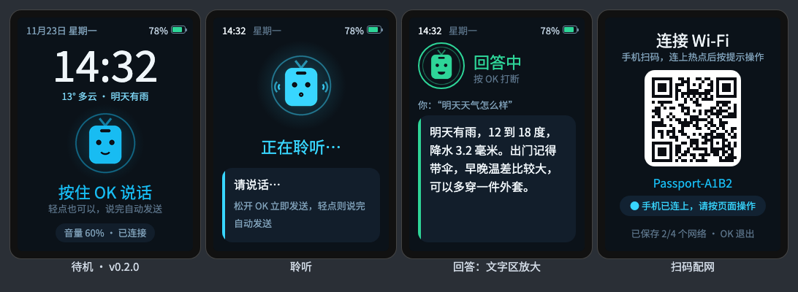
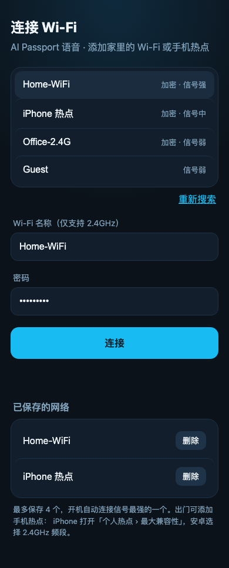
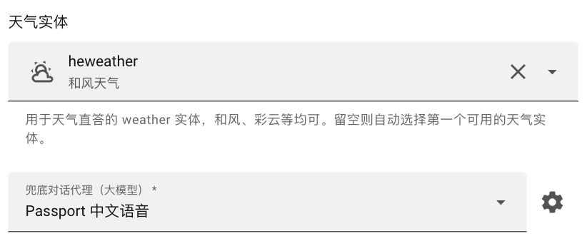
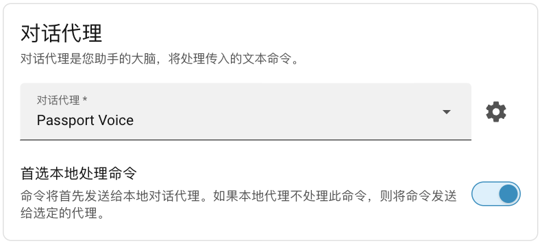

<p align="right"><a href="README.md">简体中文</a> | <strong>English</strong></p>

# AiPassport-voice

Turn the [FoloToy AI Passport](https://github.com/FoloToy/ai-passport) badge into a **Chinese-language voice terminal for Home Assistant Assist**.

[](https://esphome.io)
[](https://www.home-assistant.io)
[](https://hacs.xyz)
[](#license)

This repository contains two parts:

- **Badge firmware** (`firmware/`): based on ESPHome, with a prebuilt image for one-click web flashing. You can also build it yourself.
- **Home Assistant companion integration** (`custom_components/ai_passport_voice/`): answers time, date and weather questions locally and hands everything else to the LLM you choose. Optional.

> The badge UI, voice prompts and companion integration are designed for Simplified Chinese.

## Contents

- [Screenshots](#screenshots)
- [Features](#features)
- [Hardware](#hardware)
- [Quick start](#quick-start)
- [Usage](#usage)
- [Companion integration](#companion-integration)
- [Local speech synthesis (recommended)](#local-speech-synthesis-recommended)
- [Building from source](#building-from-source)
- [Project layout](#project-layout)
- [Known limitations](#known-limitations)
- [License](#license)
- [Acknowledgements](#acknowledgements)

## Screenshots



From left to right: idle (large clock and weather), listening, answering (enlarged text area), Wi-Fi setup by QR code.

<table>
  <tr>
    <td width="50%" valign="top">
      <br>
      The setup page opened after scanning the QR code: pick a Wi-Fi network, enter the password and manage saved networks.
    </td>
    <td width="50%" valign="top">
      <br>
      Status icons: idle, listening, thinking, answering, error, offline.
    </td>
  </tr>
</table>

> The four badge screens are rendered from the firmware layout, and the six icons are taken directly from the firmware assets. The setup page uses the page embedded in the firmware with sample network data.

## Features

- **Push to talk, release to send**: hold OK and speak; the audio is sent the moment you let go, with no wait for silence detection. A short tap lets HA decide when you have finished.
- **Interrupt at any time**: press OK while thinking or answering to stop playback, drop the old answer and start listening again.
- **Wi-Fi setup by QR code**: scan the code on the screen to configure Wi-Fi. Up to 4 networks are saved (for example home Wi-Fi and a phone hotspot). On boot the badge connects directly to the access point it used last time, and only scans for the strongest network if that fails.
- **API encryption**: Home Assistant versions that support dynamic pairing (verified on 2026.10.4) assign each badge its own key on first connection. On older HA versions supported by the integration (such as 2025.4), build the firmware yourself with a fixed key to keep the connection encrypted.
- **Chinese UI**: 240×320 screen with a large clock and weather when idle; during a conversation it shows the state, what you said and the full answer. Long answers wrap automatically and scroll slowly when they do not fit on one screen. Symbols missing from the font (such as `·`, `—` and emoji) are replaced with similar characters or dropped instead of showing boxes.
- **Online updates**: a firmware update entity appears in HA, so new releases can be installed from HA.
- **Power saving and deep sleep**: the backlight dims after 45 seconds of inactivity and turns off after 120 seconds, with Wi-Fi power saving enabled. Five minutes after the screen turns off, or when the battery drops to 3%, the badge enters deep sleep. Any button wakes it, and you can talk after about 2 seconds. It never sleeps while connected to a computer, to make debugging easier.
- **Smooth playback**: the ESPHome speaker task runs at a higher priority, so answers do not stutter while the screen redraws or network traffic arrives.
- **Audio protection**: ES8311 gain is limited to the range used by the official BSP, so even full volume does not clip.

## Hardware

Only the **FoloToy AI Passport** (ESP32-C3 transparent badge) is supported. Pins, fuel gauge and audio settings are specific to this device and will not work on other boards as-is.

| Item | Specification |
| --- | --- |
| MCU | ESP32-C3, 8 MB flash, no PSRAM |
| Display | ST7789, 240×320 |
| Audio | ES8311 codec, analog microphone + speaker |
| Power | 500 mAh battery, CW2017 fuel gauge, USB-C |
| Buttons | Power button on the left; Up / Down / OK on the right |

Home Assistant needs a working Assist pipeline (speech-to-text + conversation agent + text-to-speech). For Chinese, HA Cloud, [AI Hub](https://github.com/ha-china/ai_hub) (speech-to-text, text-to-speech and LLM conversation in one integration), or Wyoming services on your LAN (such as faster-whisper, Piper or EdgeTTS) work well.

## Quick start

### 1. Flash the firmware

Open the **[web flasher](https://jandoucn.github.io/AiPassport-voice/)** in Chrome or Edge, hold the power button to turn the badge on, connect it over USB and click "Install".

> The web flasher and prebuilt firmware are published automatically by GitHub Actions. You can also [build from source](#building-from-source).

### 2. Connect to Wi-Fi

After flashing, the badge shows a QR code. Scan it with your phone to join the `Passport-XXXX` hotspot, then pick your Wi-Fi network and enter the password in the page that opens (2.4 GHz only).

### 3. Add it to Home Assistant

In **Settings → Devices & services**, HA usually discovers the badge automatically; click "Configure". If it is not discovered, add the ESPHome integration manually and enter the badge's IP address.

### 4. Set up a voice assistant

In **Settings → Voice assistants**, create or edit an assistant, choose speech-to-text, a conversation agent and text-to-speech, then select this assistant on the badge's device page.

### 5. Install the companion integration (optional)

After installing it, set the assistant's conversation agent to **Passport Voice** so time and weather questions are answered locally and instantly. See [Companion integration](#companion-integration) for details.

## Usage

### Buttons

| Action | Behavior |
| --- | --- |
| Hold OK ≥ 0.6 s | Start listening; release to send immediately |
| Tap OK | Start listening; HA silence detection decides when you finish |
| Press OK while listening | Stop recording and send |
| Press OK while thinking or answering | Stop playback, drop the current answer, listen again |
| Up / Down | Volume +10% / −10% |
| Hold Up for 5 s (Down may be held too) | Open Wi-Fi setup |
| Press OK on the setup screen | Leave Wi-Fi setup |
| Any button | Wake from dimmed, screen-off or deep sleep |

When waking from deep sleep, the button press only turns the screen on; it does not change the volume or start a conversation. Release it, then press OK to talk.

After each answer the badge returns to idle. Even if the assistant asks a follow-up question, press OK again to start listening.

### Screen states

| State | Color | Description |
| --- | --- | --- |
| Idle | Blue | Large clock, date, weather, volume and connection status |
| Listening | Cyan | Recording |
| Thinking | Orange | Sent, waiting for a reply; shows the recognized text |
| Answering | Green | Playing audio and showing the full answer |
| Error | Red | Shows the error message |
| Offline | Gray | Not connected to Wi-Fi or Home Assistant |

### Adding or removing Wi-Fi networks

Hold Up for 5 seconds, or press "添加 Wi-Fi" (Add Wi-Fi) on the device page in HA, and the badge shows a QR code. After scanning it you can add a new network or delete saved ones.

### Device entities

Entity names are in Chinese on the device; English equivalents are shown below.

| Entity | Type | Description |
| --- | --- | --- |
| 电池电量 (Battery level) | Sensor | Battery percentage, refreshed every 30 seconds |
| 电池电压 V (Battery voltage) | Diagnostic sensor | Battery voltage |
| Wi-Fi 信号 (Wi-Fi signal) | Sensor | Signal strength |
| 通话键 (Talk button) | Binary sensor | OK button state |
| 开始对话 (Start conversation) | Button | Trigger a conversation remotely |
| 添加 Wi-Fi (Add Wi-Fi) | Configuration button | Open Wi-Fi setup |
| 屏幕背光 (Backlight) | Light | Screen brightness |
| 允许深度睡眠 (Allow deep sleep) | Configuration switch | When off, the badge does not enter deep sleep when idle (low-battery protection still applies); kept across restarts |
| 固件 (Firmware) | Update | Online updates from GitHub Releases |

## Companion integration

The integration registers a conversation agent named **Passport Voice**:

- **Local answers**: time, date, weekday and weather questions are answered inside HA without calling an LLM, within milliseconds.
- **Fallback**: everything else goes to the conversation agent you choose in the integration options (HA's built-in agent by default, or an LLM connected through AI Hub, OpenAI, Ollama and so on).
- **Control commands pass through**: sentences containing control words such as "打开" (turn on) or "关闭" (turn off), or device and room names, are always left to HA.

The integration also creates an "outdoor weather and forecast" sensor that summarizes current conditions and the next three days. The badge shows it on the idle screen.

### Prepare an LLM conversation agent first (AI Hub recommended)

The "fallback conversation agent" dropdown lists the **conversation agents** that already exist in HA, not model names. Each agent wraps one configured model (model, prompt and device control permissions live in the agent's own settings), so connect an LLM through an integration first.

[AI Hub](https://github.com/ha-china/ai_hub) (installable through HACS) is recommended:

- One integration provides a conversation agent, speech-to-text and text-to-speech (Edge TTS), so the badge's entire Assist pipeline can be built with it.
- It uses free model services by default; register an account and enter the API key.
- Each model is a separate conversation agent and can use a cloud model or a local model behind an OpenAI-compatible API on your LAN. Pick any of them as the fallback here.

HA's built-in OpenAI, Google Gemini and Ollama integrations also work. HA's own Home Assistant agent only handles built-in intents such as device control and cannot chat.

### Installation

**HACS (recommended)**

1. HACS → top-right menu → **Custom repositories**, enter `https://github.com/jandoucn/AiPassport-voice` and choose the "Integration" category.
2. Search for **AiPassport-voice** and download it.
3. Restart Home Assistant.

**Manual installation**

Copy `custom_components/ai_passport_voice/` from this repository into `custom_components/` in your HA configuration directory (using the Samba, SSH or File editor add-on), then restart Home Assistant.

### Configuration

1. Open **Settings → Devices & services → Add integration** and search for "AI Passport 语音".
2. Choose a weather entity and a fallback conversation agent in the form, then click "Submit".

   

   | Option | Description |
   | --- | --- |
   | Weather entity | Any `weather` entity (QWeather, Caiyun, Met.no and so on). Daily, day/night and hourly forecasts are supported, with automatic conversion to Celsius and millimeters. If left empty, the first available weather entity is used |
   | Fallback conversation agent (LLM) | Answers questions other than time, date and weather, for example a model configured in AI Hub, OpenAI or Ollama. The dropdown shows these agents by the names they have in your own HA (the screenshot shows a Gemma agent from AI Hub). The default is HA's built-in Home Assistant agent, which only handles built-in intents such as device control |

   The integration can only be added once. To change it later, click the gear icon on the integration page to open the same form.

3. Open **Settings → Voice assistants**, edit the assistant used by the badge, set **Conversation agent** to **Passport Voice** and click "Update".

   

   "Prefer handling commands locally" can stay on: device control sentences that HA's built-in intents recognize run locally first, and the rest go to Passport Voice.

4. On the badge's device page, make sure "Assistant" is set to this voice assistant.

### Verification

- In **Developer tools → States**, search for `sensor.shi_wai_tian_qi_yu_yu_bao`. Its state should be a Chinese weather summary, and its `source_entity` attribute should be the weather entity you chose.
- Switch to this assistant in the Assist dialog at the top right of HA and enter "现在几点了" (what time is it) or "明天天气怎么样" (what is the weather tomorrow); the answer should be instant. Other questions should be answered by the fallback agent.
- You can also call `conversation.process` in **Developer tools → Actions**:

  ```yaml
  action: conversation.process
  data:
    agent_id: conversation.passport_voice
    text: 明天天气怎么样
  ```

To troubleshoot, enable debug logging in `configuration.yaml`:

```yaml
logger:
  logs:
    custom_components.ai_passport_voice: debug
```

## Local speech synthesis (recommended)

After you finish speaking, the badge waits for text-to-speech (TTS) to produce audio. Cloud TTS makes a round trip to the internet every time; running it locally shortens this wait noticeably. [`tools/kokoro-wyoming/`](tools/kokoro-wyoming/) provides a Chinese [Kokoro-82M](https://huggingface.co/hexgrad/Kokoro-82M) speech service that connects to HA over the Wyoming protocol and synthesizes sentence by sentence while the answer is still being generated.

Synthesizing a Chinese weather report of about 30 characters in the same HA, three runs each (times measured from the request):

| TTS | First audio chunk | Synthesis complete |
| --- | --- | --- |
| Kokoro local (Apple M4 Max) | 0.2–0.6 s | 0.3–1.1 s |
| Edge TTS (cloud) | 1.9–2.7 s | 3.9–4.9 s |
| Google Translate TTS (cloud) | 1.5 s | 1.5 s, with 2 other runs timing out (network in mainland China) |

Local TTS is also unaffected by internet fluctuations and does not send replies to a third party.

### Deployment (Apple Silicon Mac)

The service is built on Apple MLX and needs an M-series Mac on the same LAN as HA.

```bash
cp -R tools/kokoro-wyoming ~/kokoro-wyoming && cd ~/kokoro-wyoming
uv venv && uv pip install -r requirements.txt
# The first run downloads the model from Hugging Face; press Ctrl+C once "Kokoro 已就绪" (Kokoro ready) appears
.venv/bin/python kokoro_wyoming.py --uri tcp://0.0.0.0:10210 --voice zf_xiaoxiao
```

To start it at login, replace `/path/to/kokoro-wyoming` in `com.aipassport.kokoro-tts.plist` with the actual directory, then:

```bash
cp com.aipassport.kokoro-tts.plist ~/Library/LaunchAgents/
launchctl load ~/Library/LaunchAgents/com.aipassport.kokoro-tts.plist
```

The plist sets `HF_HUB_OFFLINE=1`, so the service no longer checks for model updates online once the model is downloaded. Logs go to `kokoro.log`. The example listens on all interfaces; use it on a trusted LAN, or restrict the source to HA with the host firewall.

### Connecting to Home Assistant

1. **Settings → Devices & services → Add integration**, choose **Wyoming Protocol**, enter the Mac's LAN IP as the host and `10210` as the port.
2. **Settings → Voice assistants**, edit the assistant used by the badge, choose **kokoro** for text-to-speech, then pick a voice.

Available voices: female `zf_xiaoxiao`, `zf_xiaobei`, `zf_xiaoni`, `zf_xiaoyi`; male `zm_yunjian`, `zm_yunxi`, `zm_yunxia`, `zm_yunyang`. Adjust the speaking rate with the `--speed` argument (default `1.0`).

## Building from source

Requires [ESPHome](https://esphome.io) 2026.10 or newer.

### Command line

```bash
git clone https://github.com/jandoucn/AiPassport-voice.git
cd AiPassport-voice/firmware
esphome run passport-voice.yaml
```

The core configuration sets up Wi-Fi by QR code, and HA versions with dynamic pairing provide the API key. Flash over USB the first time; later updates can be wireless.

### ESPHome Dashboard

When a badge running the prebuilt firmware joins the network, the ESPHome Dashboard discovers it and offers "Take Control". Taking control creates a device file that references this repository's configuration, which you can then customize.

### Updating a paired badge

To keep the original device name, API key and Wi-Fi of a badge already added to HA:

```bash
cd firmware
cp -n examples/paired-device.yaml passport-voice.local.yaml
# Fill in api_encryption_key, wifi_ssid and wifi_password in firmware/secrets.yaml
# Make sure name and mac_suffix in the local config match the original device
esphome run passport-voice.local.yaml --device <original device address>
```

`run` compiles the configuration for this device, then writes the application partition over OTA. The example keeps the original name `passport-voice`; for other device names, set the original value in `substitutions`. `*.local.yaml` and `secrets.yaml` stay on your machine only.

#### Updating the bootloader (optional, faster wake from deep sleep)

The firmware lets the bootloader skip full image verification when waking from deep sleep, saving about 0.5 seconds. OTA only updates the application partition, so the bootloader must be written once over USB (the web flasher writes it automatically). Only the bootloader at `0x0` is written; Wi-Fi and pairing data in NVS are not affected:

```bash
cd firmware
esphome compile passport-voice.local.yaml
# Back up the current bootloader first
esptool --chip esp32c3 -p <serial port> read-flash 0x0 0x8000 bootloader-backup.bin
esptool --chip esp32c3 -p <serial port> write-flash --flash-mode keep --flash-freq keep --flash-size keep \
  0x0 .esphome/build/passport-voice/build/bootloader/bootloader.bin
```

The badge works normally without this update; it just wakes a little slower.

### Debugging

```bash
esphome logs passport-voice.yaml --device <device address or serial port>
```

For voice pipeline problems, check HA's **Settings → Voice assistants → Debug** first.

## Project layout

```
.
├── custom_components/ai_passport_voice/   # Home Assistant companion integration
├── firmware/
│   ├── passport-voice.yaml                # Core configuration (self-build, Dashboard takeover)
│   ├── passport-voice.factory.yaml        # Prebuilt firmware (web flasher, online updates)
│   ├── packages/                          # hardware / ui / voice / wifi / power (deep sleep)
│   ├── components/
│   │   ├── voice_assistant/               # Modified ESPHome voice assistant component
│   │   ├── passport_wifi/                 # QR-code Wi-Fi setup and multiple saved networks
│   │   └── cw2017/                        # Fuel gauge
│   ├── assets/                            # Fonts, status icons
│   ├── examples/                          # Example for updating a paired device
│   ├── passport_helpers.h                 # On-device helper functions
│   ├── passport_text.h                    # Missing-glyph replacement (pure logic, unit-testable on a computer)
│   └── passport_sleep.h                   # Deep sleep decision (pure logic, unit-testable on a computer)
├── tools/kokoro-wyoming/                  # Local Chinese speech synthesis service (Wyoming)
├── static/                                # Web flasher (GitHub Pages)
├── .github/workflows/                     # Tag releases, integration validation, YAML lint
├── hacs.json
├── LICENSE
└── NOTICE.md
```

### Release process

1. Update `version` in `custom_components/ai_passport_voice/manifest.json`, for example `0.2.0`, then commit and push.
2. Create and push a tag with the same version:

   ```bash
   git tag v0.2.0
   git push origin v0.2.0
   ```

3. The `Release` workflow builds the firmware, publishes a GitHub Release (with flashing files and the online update manifest) and updates the web flasher. It fails immediately if the tag does not match the version in `manifest.json`.

After pushing `main` for the first time, set Source to **GitHub Actions** under **Settings → Pages**. You can run **Actions → Release → Run workflow** on `main` to build and download test artifacts before creating an official tag. The same workflow also builds firmware changes in pull requests.

| Workflow | Purpose |
| --- | --- |
| `release.yml` | Build, publish and update the web flasher on tags; build only in PRs |
| `validate.yml` | hassfest and HACS validation for the integration |
| `yaml-lint.yml` | YAML formatting checks |

## Known limitations

- **Depends on a modified `voice_assistant` component**: release-to-send and dropping old answers on interrupt are implemented in a locally overridden ESPHome component. It must be updated if upstream interfaces change in a future ESPHome release.
- **About 9% flash left** (prebuilt firmware with HTTP online updates): the GB2312 Chinese font takes a lot of space, so watch the size when adding features.
- **The device is offline during deep sleep**: while asleep it cannot be triggered remotely from HA or updated over OTA; press a button to wake it. Waking is a reboot, so it reconnects to Wi-Fi and HA.
- **Only a computer counts as "plugged in"**: the badge only detects a computer's USB host; on a phone charger it still enters deep sleep when idle. To keep it on as a clock, turn off "允许深度睡眠" (Allow deep sleep) in HA.
- **No wake word**: the ESP32-C3 is too limited, so conversations are push-to-talk only.
- **The setup hotspot has no password**: it only opens when you start Wi-Fi setup and closes once connected or when you press OK.
- **The prebuilt firmware allows LAN OTA**: as in ESPHome's official project template, `esphome` OTA has no password. If this matters to you, take control of the device or build it yourself with an OTA key.

## License

- This repository's own code is released under the [MIT](LICENSE) license.
- The C++ code in `firmware/components/voice_assistant/` is modified from ESPHome and released under [GPLv3](firmware/components/voice_assistant/LICENSE); the compiled firmware links ESPHome's GPLv3 runtime.
- See [NOTICE.md](NOTICE.md) for fonts and other third-party content.

## Acknowledgements

- [FoloToy AI Passport](https://github.com/FoloToy/ai-passport): hardware design, BSP pins, battery curve and Wi-Fi setup logic
- [ESPHome](https://esphome.io): firmware framework, voice assistant component and project template
- [Home Assistant](https://www.home-assistant.io): Assist voice pipeline
- [Noto Sans SC](https://github.com/notofonts/noto-cjk): Chinese font
